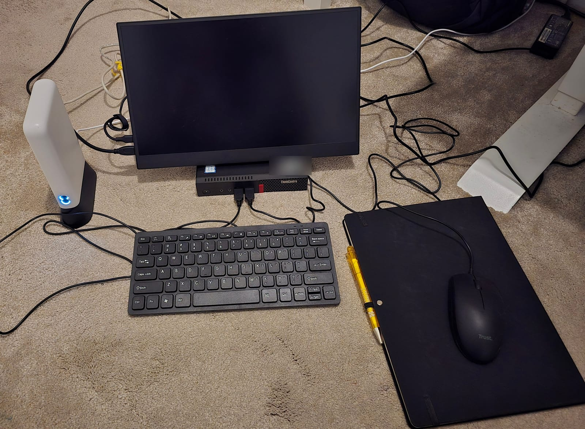
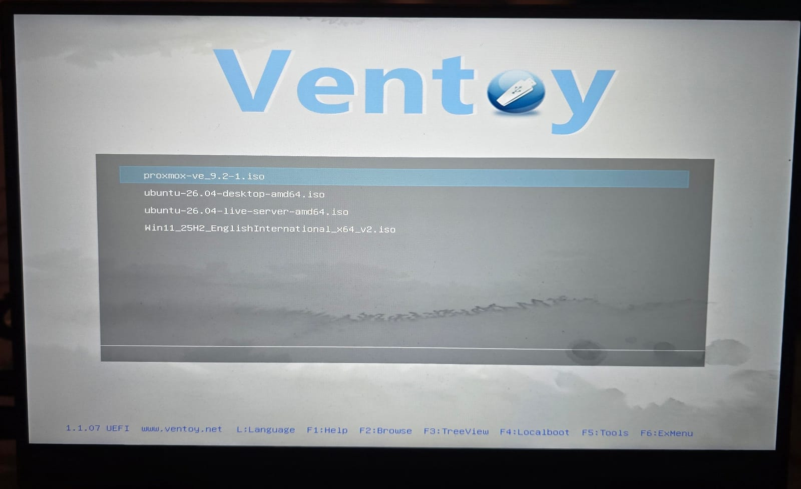
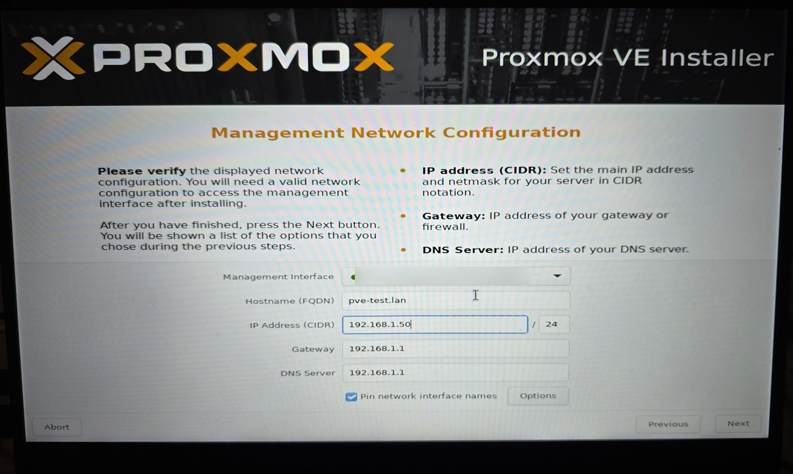
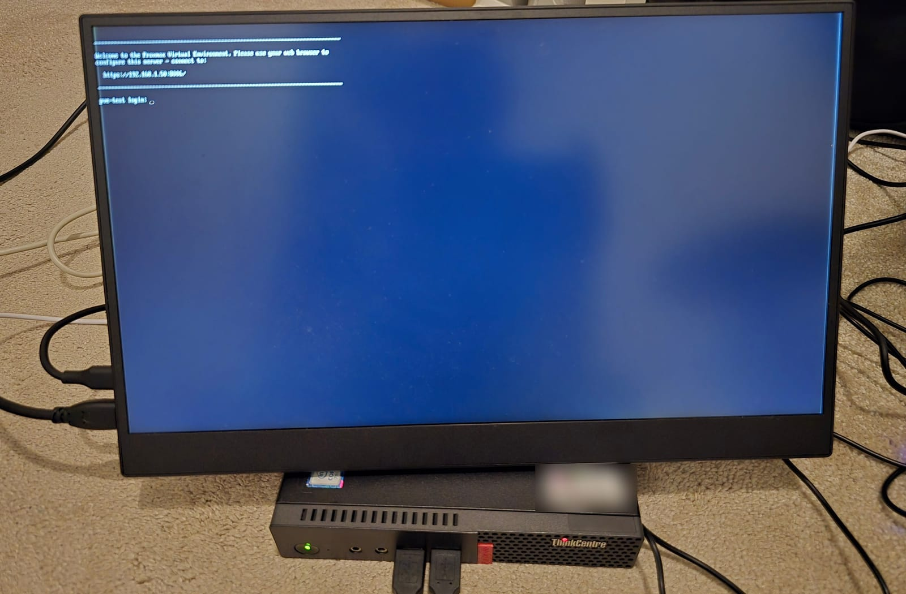
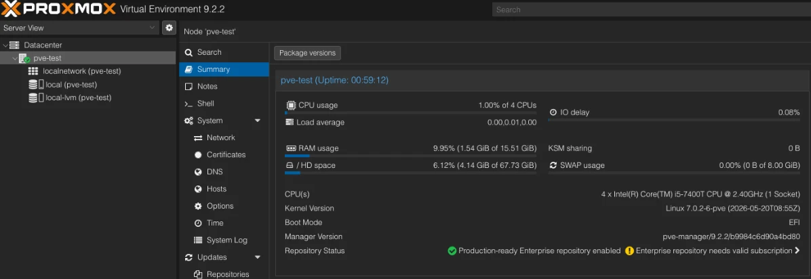

I wanted somewhere to run experiments that couldn't touch my home network. If something goes wrong, I want it to go wrong in a box I can wipe.

So I built a small lab that has nothing to do with the rest of the house.

## The setup

There are three pieces:

- **The server.** A Lenovo ThinkCentre Tiny with an Intel Core i5-7400T (4 cores), 16 GB of RAM and a 256 GB NVMe drive. It runs Proxmox.
- **The router.** An EE 4G router with a Three SIM in it. The server plugs into it with a cable.
- **A laptop.** A Dell Precision 3550 running Ubuntu. It connects to the router's Wi-Fi. I use it to manage the server.

Nothing else is connected to that router.

## How it stays separate

The lab has its own internet connection, over mobile data. It doesn't share a router, a cable or a Wi-Fi network with anything else in the house.

Nothing on my home network can reach the server. The only way in is the laptop.

The laptop doesn't have my home Wi-Fi password, so it can't join my home network, even by accident. It only ever connects to the lab.

The laptop is there so I don't have to sit on the floor next to the server. I can manage it from anywhere in the house within range of the router's Wi-Fi.

## Installing Proxmox

I used a [Ventoy](https://www.ventoy.net) USB stick. You copy ISO files onto it, and it gives you a menu to boot whichever one you want. Mine has Proxmox, Ubuntu and Windows on it.

From there it's the standard Proxmox installer. I picked the NVMe drive, set the country and time zone, and chose a root password.

The one step that matters is the network. I gave the server a fixed address on the router's network, `192.168.1.50`, with the router at `192.168.1.1` as the gateway and DNS.

A fixed address means the laptop always knows where to find the server.

After a reboot, the server tells you where its admin page is:

From then on I open `https://192.168.1.50:8006` on the laptop and do everything from the browser.

## Where it is now

It's running Proxmox VE 9.2.2. Sitting idle, it uses about 1.5 GB of its 16 GB of RAM and almost none of the CPU.

The Proxmox dashboard shows the root disk as about 68 GB, even though the drive is 256 GB. That's normal. The installer keeps the system partition small and puts the rest of the drive aside for virtual machines. That's the `local-lvm` storage in the list on the left.

That's the whole setup. Now I have somewhere to break things.
