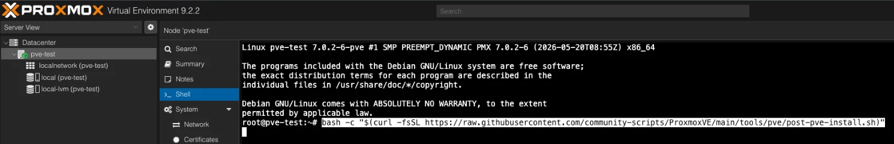
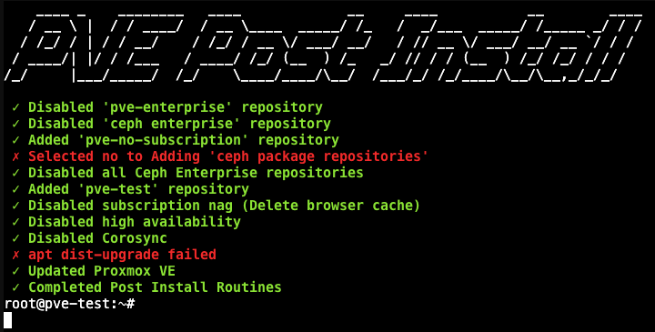

In my [last post](/blog/a-sandbox-for-my-experiments/) I built a Proxmox sandbox on its own 4G network. This is what I do once the installer has finished.

## The post-install script

I run the [post-install script](https://community-scripts.org/scripts/post-pve-install) from the Proxmox community scripts. In the Proxmox web page, I open the server's Shell and paste this in:

```
bash -c "$(curl -fsSL https://raw.githubusercontent.com/community-scripts/ProxmoxVE/main/tools/pve/post-pve-install.sh)"
```

This downloads a script and runs it as root. It's a community project, not an official Proxmox tool, so [read it on GitHub](https://github.com/community-scripts/ProxmoxVE/blob/main/tools/pve/post-pve-install.sh) before you run it.



It asks a series of yes/no questions, then lists what it did:



I say yes to everything except the Ceph package repositories. That includes fixing the package sources and rebooting at the end.

Ceph, high availability and Corosync are for running several Proxmox servers as a cluster. The sandbox is a single server, so it doesn't need them.

The change that matters most is the repositories. Out of the box, Proxmox gets its updates from the enterprise repository, which needs a paid subscription. The script switches it to the free `pve-no-subscription` repository, so updates work.

## Updating

The script's own update failed (the red line above), and it hides the reason. So I update by hand:

```
apt update
pveupgrade
apt autoremove
```

`apt update` checks for new versions, `pveupgrade` installs them, and `apt autoremove` clears out anything no longer needed.

On the sandbox there were 183 updates waiting, including Proxmox itself and a new kernel:

```
183 upgraded, 2 newly installed, 0 to remove and 0 not upgraded.
...
Your System is up-to-date

Seems you installed a kernel update - Please consider rebooting
this node to activate the new kernel.
```

After a reboot, the sandbox is on Proxmox 9.2.21 with the 7.0.14 kernel.

## Getting ISOs ready

Most of the servers I build use [Debian](https://www.debian.org/) or [Ubuntu Server](https://ubuntu.com/download/server), so I get both ready straight away. In Proxmox, I go to the `local` storage, then ISO Images, then Download from URL, and paste in each ISO's link. Proxmox downloads it straight onto the server.

## Nothing for remote access

Because this is my sandbox, I don't install Tailscale or anything like it. It's meant to stay isolated, so the only way in is the laptop on its own Wi-Fi.

The downside is that I can only use the sandbox when I'm at home, within range of that Wi-Fi. That's the price of keeping it isolated.
