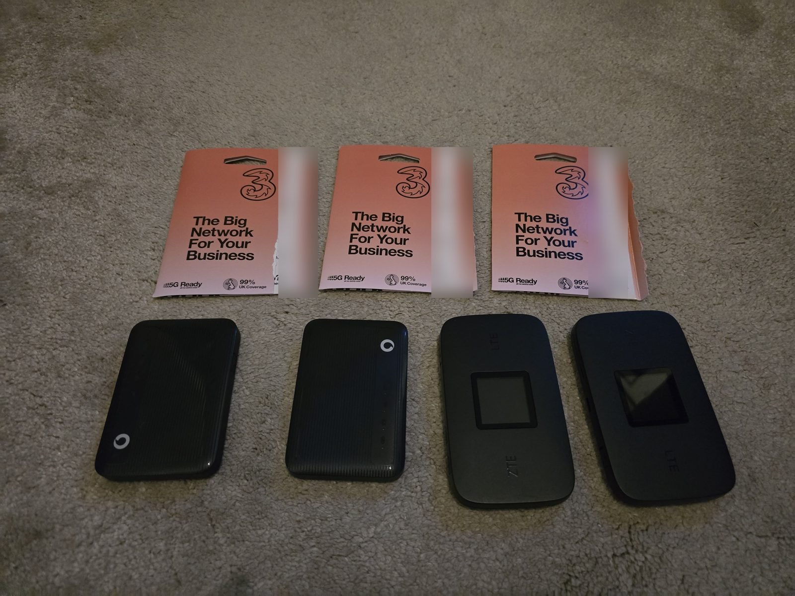
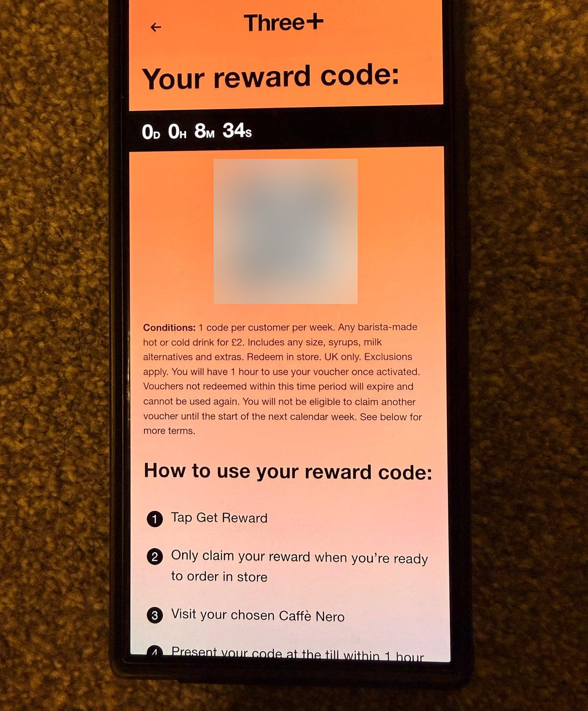
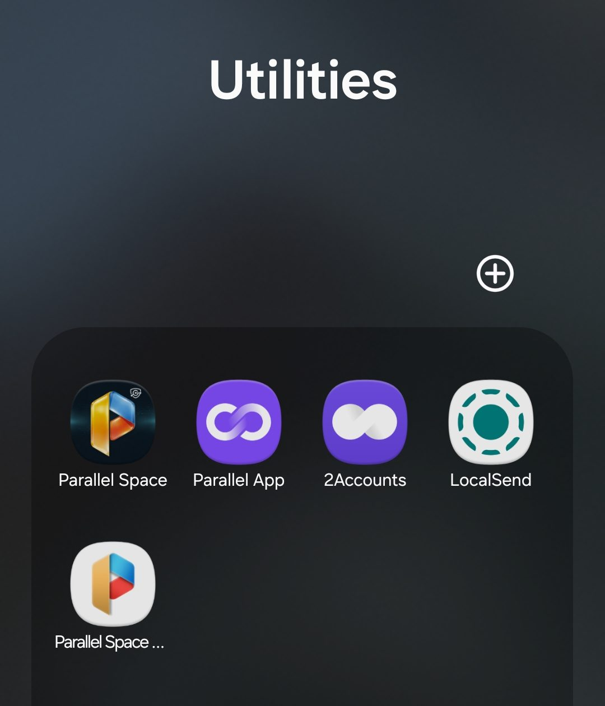
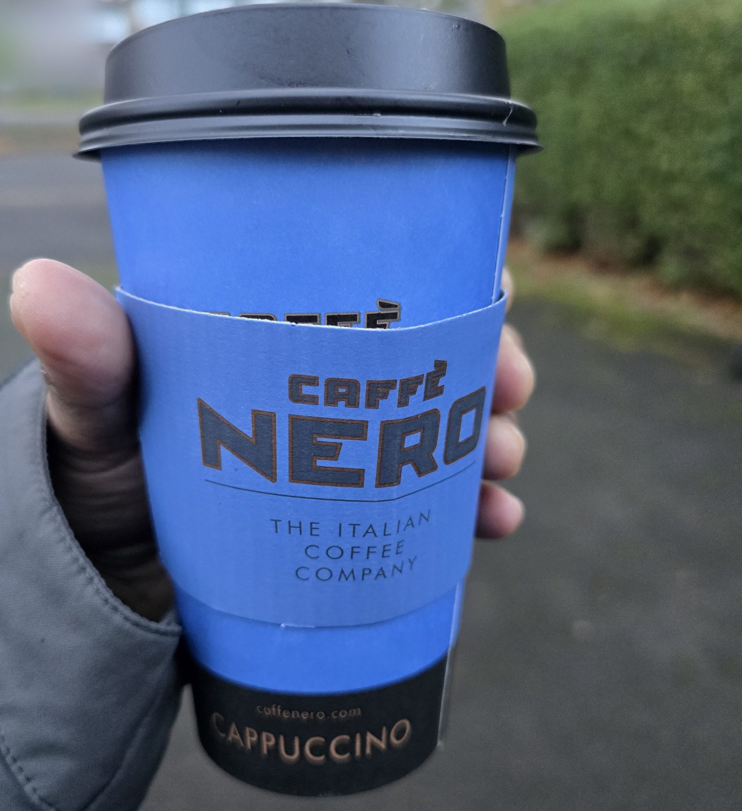

Most mornings, I'm up at 3:30am. With twin boys at home, if I want any time to myself, it has to be before everyone else wakes up. So the early hours are mine: working on my startups, some meditation, a walk.

And a coffee. A large oat latte from my local Caffè Nero, first thing. Caffè Nero is known for its coffee, and it really is good. It's about £4.50 a day, and it adds up: over a year, that's more than £1,600.

So I found a way to pay £1 for it instead. It's £2 now, but I'll get to that.

## Three+

Three, the mobile network, has a rewards programme. It's had a few different names over the years, and now it's called Three+. If you're a Three customer, you're in it.

One of the rewards is a weekly Caffè Nero drink. It used to be £1. A couple of months ago it went up to £2. The terms on the reward screen are pretty generous:

- One code per customer per week
- Any barista-made hot or cold drink, any size
- Milk alternatives and extras included
- One hour to use it once you've activated it

## Why one SIM isn't enough

The catch is that each Three number only gets one £2 coffee a week. I have one every day, so I'd need seven numbers to cover the whole week.

More Three SIMs would mean more rewards, but a normal SIM means a contract, and even a cheap one is around £10 a month. For six extra SIMs, that's £60 a month just to unlock six coffees a week. That wipes out almost all of the saving.

## The trick

Then I found out about Three business data SIMs, sold through a reseller. You pay £25 once and get 10GB of data a month for two years. No top-ups, nothing else to pay.

Each one comes with its own number, and each number can be registered with Three+. So I bought seven. Seven SIMs, seven coffees a week.

Offers like this change, so if you fancy trying it, check what's on offer now rather than taking my prices as gospel.

## The honest bit

It's a loophole, and you do have to go out of your way for it. Here's what it takes:

- **Cheap phones.** £8 4G phones, so each SIM can receive its registration text.
- **Old pocket hotspots.** These hold the SIMs.
- **Clone apps.** You need the Three+ app open to show the QR code, so I use apps like Parallel Space to run several copies of it on one phone.

It's fiddly, and I won't pretend otherwise. But I've done it long enough that I've got it down to a routine.

Each SIM gets its own day of the week. In the morning, I open that day's copy of the Three+ app, find the Caffè Nero reward and activate it. That starts the one-hour clock, so I only do it once I'm heading in. I show the QR code, pay £2, and that number's reward is done for the week. Tomorrow, it's the next copy of the app.

## The money

Each SIM costs £25 and lasts two years. So seven of them cost £175, and that pays for two years of coffees. When the first seven ran out, I bought another seven. In total, I've spent £350 on SIMs.

Then there's the kit. The phones and pocket hotspots cost about £8 to £10 each, so they barely add anything.

The latte normally costs £4.50. When I was paying £1, I saved £3.50 every time. Now that I pay £2, I save £2.50.

I've done this almost every day for about three years. Even after paying for the SIMs and the kit, I've saved nearly £3,000. So it still works out really well.

## Still a bargain

The price going up to £2 stung a little. But a large oat latte for £2, every morning, is still a bargain.

